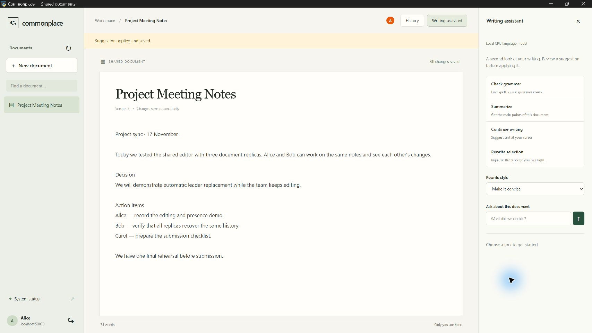
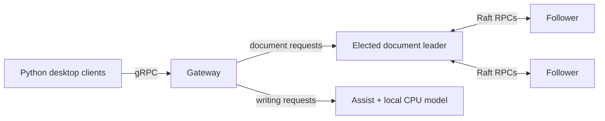

# Commonplace

A shared document editor built for **Advanced Operating Systems, CS G623 — Project C**.

Commonplace lets several users edit the same notes, see who is online and review every saved version. Three Python document servers use Raft to agree on edits and keep independent logs on disk. A separate CPU model provides writing assistance.

[Project page](https://aryan1078.github.io/commonplace/) · [Setup](docs/SETUP.md) · [Architecture](docs/ARCHITECTURE.md) · [Test results](docs/results.md) · [Slides](docs/Commonplace-project.pptx)



## Run it

Use **Python 3.11 on Windows**.

```powershell
git clone https://github.com/aryan1078/commonplace.git
cd commonplace
& ".\Start Commonplace.cmd"
```

The launcher installs the desktop dependencies, starts the local services and opens the sign-in screen. For the classroom demo, use `alice / alice123` or `bob / bob123`. Open two windows, choose the same document and start typing. Changes save automatically. **History** shows authors and versions, and **System status** shows the elected leader.

Run **Set up real AI.cmd** once to download Qwen2.5-1.5B-Instruct, then restart the demo. The model runs locally on CPU. Until it is installed, the assistant clearly labels its responses as demo output. Use **Stop demo.cmd** when finished. Saved documents remain on disk.

## How an edit is saved



The gateway authenticates requests and finds the leader. The leader records a command, replicates it to a majority and applies the committed log in order. Clients receive committed updates over gRPC streams. A stale edit fetches the missing history, adjusts its positions and retries with the same operation ID.

The desktop screen uses a local HTML/CSS/JavaScript view. Authentication, editing, networking, consensus and inference services are Python.

## Verify recovery

```powershell
.venv\Scripts\python.exe -m pytest
.venv\Scripts\python.exe scripts/verify_cluster.py
```

The recorded Windows run passed **147 tests**. The process-level check killed the elected leader during **200 concurrent edits**, then verified history replay, client agreement, replica catch-up, duplicate retries and a full restart on the original disks. It also checked that losing a majority prevents fresh reads and writes. [Results and transcripts](docs/results.md)

## Deployment and scope

The local demo uses independent processes and disks on one laptop. Clients can connect to a LAN gateway or a TLS-enabled remote gateway. [Deployment instructions](deploy/DEPLOYMENT.md)

Membership is fixed at three voters. Logs use full replay without compaction. A gateway restart requires users to sign in again. Model suggestions need review. The measured deployment is Windows processes; Docker and separate-machine deployment need rehearsal.

This continues the team's [earlier collaboration project](https://github.com/Krisha-cmd/collab-platform), retaining its Python baseline history. Raft follows [Ongaro and Ousterhout's extended paper](https://raft.github.io/raft.pdf). The local model is [Qwen2.5-1.5B-Instruct](https://huggingface.co/Qwen/Qwen2.5-1.5B-Instruct).
