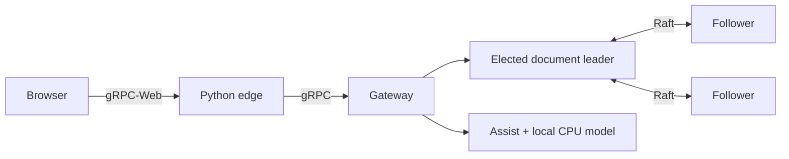

# Commonplace

[](https://github.com/aryan1078/commonplace/actions/workflows/tests.yml)

A shared document editor for Advanced Operating Systems, Project C. Write together in your browser, see who is online, review saved versions and ask a local CPU model for writing help. Three Python document servers use Raft to agree on edits and keep independent logs on disk.

**[Open the editor](https://aryan1078.github.io/commonplace/)** · [Host setup](docs/SETUP.md) · [Architecture](docs/ARCHITECTURE.md) · [Test results](docs/results.md) · [Slides](docs/Commonplace-project.pptx)


## Try it

Open the editor and expand **Using the course demo?**. Choose Alice or Bob, sign in, then open a document or create one. Changes save automatically. Open another tab with a different account to write together. **History** shows authors and versions; **System status** shows the elected leader.

Visitors install nothing. The free demo runs through a temporary HTTPS tunnel to the host laptop, which must stay awake and connected. If it is offline, the sign-in screen explains that. The shared demo accounts can read and edit all documents; use sample notes only.

## Run your own demo

The host needs Python 3.11. On Windows:

```powershell
git clone https://github.com/aryan1078/commonplace.git
cd commonplace
& ".\Start online demo.cmd"
```

This installs the host dependencies, starts the Python services and prints a free public browser URL using OpenSSH and localhost.run. No hosting account is needed. The repository-owner launcher uses authenticated `gh` to keep the published editor connected as the tunnel rotates. For a direct tunnel without GitHub publication, run **Start browser demo.cmd --share**. **Start browser demo.cmd** runs locally; add `--lan` to share on a trusted network. **Start Commonplace.cmd** opens the optional desktop client.

Run **Set up real AI.cmd** once to download Qwen2.5-1.5B-Instruct, then restart the demo. Until installed, the assistant labels its output as demo responses. **Stop demo.cmd** stops the host services; documents remain on disk. [Hosting and URL updates](deploy/DEPLOYMENT.md)

## How a save works



The gateway authenticates the user and finds the leader. The leader persists a command, replicates it to a majority and applies the committed log in order. Stale edits fetch history, adjust positions and retry with the same operation ID. Accepted AI suggestions follow this same save path.

## Verification and scope

```powershell
.venv\Scripts\python.exe -m pytest
.venv\Scripts\python.exe scripts/verify_cluster.py
```

The Windows run passed **149 tests**, including binary gRPC-Web, two browser sessions, live updates, history, logout and request limits. The process check kills the leader during 200 concurrent edits, then verifies replay, replica catch-up and recovery on the original disks. CI repeats the checks on Windows and Linux.

Membership is fixed at three voters, with full-log replay. Gateway and browser sessions are in memory. The measured deployment uses processes on one laptop. Model suggestions need review.

Based on the team's [earlier project](https://github.com/Krisha-cmd/collab-platform), [Raft](https://raft.github.io/raft.pdf) and [Qwen2.5](https://huggingface.co/Qwen/Qwen2.5-1.5B-Instruct).
